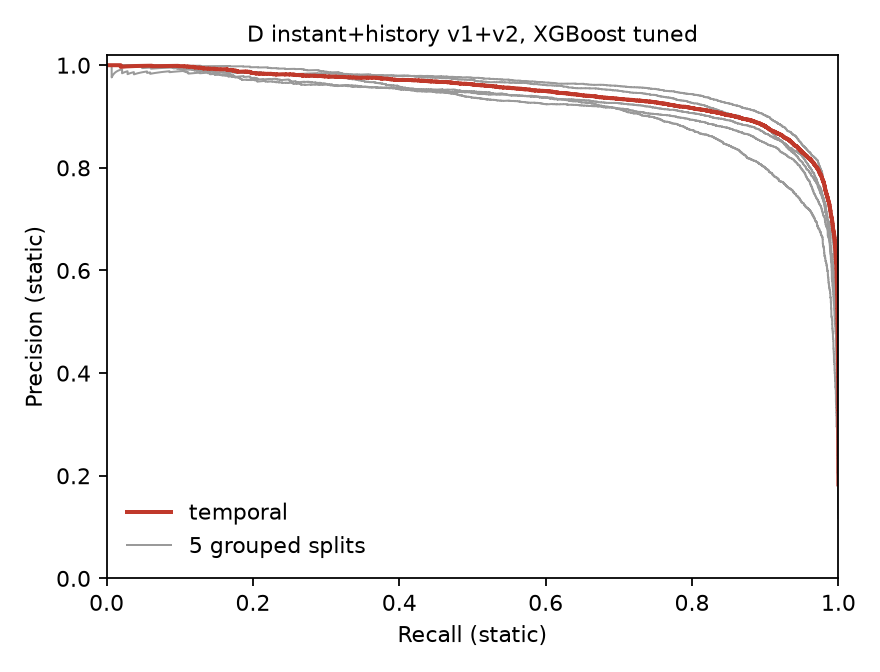

# Summary: history tier, version 2

Label: NASA type (static = 2, fire = 0, types 1 and 3 dropped). The type label is produced by NASA's own algorithm. No coordinates, no hour_utc.

**Setups B, D and E use past detections of the same place and are not single reading results.** Every history feature uses only detections on days strictly before the detection, within the same raw file.

- B: instant features + history v1 (numbers reused from the earlier run)
- D: instant + history v1 + v2
- E: history v1 + v2 only

Models: Random Forest and XGBoost, 100 trees, default settings; XGBoost tuned by a random search of 20 configurations with 3 grouped folds on the training part of each split only, selected by pooled out-of-fold static PR-AUC. Thresholds come from out-of-fold predictions on the training part. The rule is static if distinct_days_prior_30 >= k, with k picked on the training part.

History v2 adds: distinct days over 60 and 90 days, the 3x3 neighbourhood over 60 days, days since last seen, persistence_30, the mean and std of bright_ti4 and frp over the prior 30 days with a has_history flag, and the deviation of the current reading from that mean (set to 0 when there is no prior detection).

## Leakage test

tests/test_history.py: for 40 random detections, every other row on or after the detection's date was moved, re-dated, given new readings, dropped and duplicated. All 19 history features (v1 and v2) of the detection stayed the same in every case (passed, tolerance 1e-6 for float features). A hand computed known value test, including the means and stds, also passed.

Reproducibility: rerunning B with default models reproduces the earlier CSVs; the largest absolute difference over all metrics is 0.000000.

## a) Five grouped splits (seeds 42 to 46), mean (std) of static metrics

Test rows: all rows (about 51,325 per split). Majority baseline PR-AUC about 0.142.

| Setup | Model | PR-AUC | Precision | Recall | F1 |
|---|---|---|---|---|---|
| Rule | distinct_days_prior_30 >= k, k per seed 3,3,3,3,3 | 0.777 (0.040) | 0.765 (0.031) | 0.811 (0.017) | 0.787 (0.023) |
| B instant+history | Random Forest | 0.919 (0.019) | 0.837 (0.018) | 0.905 (0.011) | 0.870 (0.014) |
| B instant+history | XGBoost | 0.922 (0.019) | 0.836 (0.021) | 0.906 (0.010) | 0.870 (0.015) |
| B instant+history | XGBoost tuned | 0.926 (0.019) | 0.841 (0.022) | 0.909 (0.012) | 0.874 (0.017) |
| D instant+history v1+v2 | Random Forest | 0.929 (0.019) | 0.845 (0.021) | 0.911 (0.017) | 0.877 (0.018) |
| D instant+history v1+v2 | XGBoost | 0.933 (0.017) | 0.840 (0.019) | 0.914 (0.019) | 0.875 (0.018) |
| D instant+history v1+v2 | XGBoost tuned | 0.936 (0.017) | 0.845 (0.026) | 0.915 (0.016) | 0.879 (0.020) |
| E history v1+v2 only | Random Forest | 0.915 (0.020) | 0.839 (0.034) | 0.884 (0.019) | 0.860 (0.021) |
| E history v1+v2 only | XGBoost | 0.924 (0.017) | 0.842 (0.024) | 0.901 (0.012) | 0.870 (0.018) |
| E history v1+v2 only | XGBoost tuned | 0.924 (0.017) | 0.844 (0.024) | 0.898 (0.014) | 0.870 (0.019) |

Test rows: days_into_data >= 30 (about 45,756 per split). Majority baseline PR-AUC about 0.143.

| Setup | Model | PR-AUC | Precision | Recall | F1 |
|---|---|---|---|---|---|
| Rule | distinct_days_prior_30 >= k, k per seed 3,3,3,3,3 | 0.795 (0.040) | 0.764 (0.033) | 0.846 (0.016) | 0.803 (0.024) |
| B instant+history | Random Forest | 0.926 (0.019) | 0.842 (0.018) | 0.920 (0.012) | 0.879 (0.014) |
| B instant+history | XGBoost | 0.930 (0.019) | 0.843 (0.021) | 0.920 (0.012) | 0.880 (0.016) |
| B instant+history | XGBoost tuned | 0.933 (0.019) | 0.847 (0.022) | 0.922 (0.013) | 0.883 (0.018) |
| D instant+history v1+v2 | Random Forest | 0.936 (0.020) | 0.850 (0.023) | 0.925 (0.016) | 0.886 (0.019) |
| D instant+history v1+v2 | XGBoost | 0.940 (0.017) | 0.847 (0.022) | 0.928 (0.017) | 0.885 (0.019) |
| D instant+history v1+v2 | XGBoost tuned | 0.943 (0.017) | 0.851 (0.027) | 0.927 (0.015) | 0.887 (0.020) |
| E history v1+v2 only | Random Forest | 0.926 (0.020) | 0.853 (0.030) | 0.903 (0.019) | 0.877 (0.021) |
| E history v1+v2 only | XGBoost | 0.934 (0.017) | 0.847 (0.026) | 0.922 (0.011) | 0.883 (0.019) |
| E history v1+v2 only | XGBoost tuned | 0.935 (0.018) | 0.849 (0.026) | 0.919 (0.012) | 0.883 (0.019) |

### Paired differences over the 5 splits (all rows)

Mean difference (std of the per split differences). "Inside spread" means the mean difference is smaller than one std of the differences.

| Comparison | PR-AUC diff |  | F1 diff |  |
|---|---|---|---|---|
| D XGBoost vs B XGBoost | +0.011 (0.003) | outside spread | +0.006 (0.004) | outside spread |
| E XGBoost vs B XGBoost | +0.002 (0.003) | inside spread | +0.001 (0.004) | inside spread |
| D XGBoost tuned vs D XGBoost | +0.003 (0.002) | outside spread | +0.003 (0.003) | outside spread |
| E XGBoost tuned vs E XGBoost | +0.000 (0.002) | inside spread | +0.000 (0.003) | inside spread |
| B XGBoost tuned vs B XGBoost | +0.004 (0.001) | outside spread | +0.004 (0.002) | outside spread |
| D XGBoost tuned vs B XGBoost | +0.014 (0.004) | outside spread | +0.009 (0.006) | outside spread |
| D Random Forest vs B Random Forest | +0.010 (0.003) | outside spread | +0.007 (0.005) | outside spread |
| best (D instant+history v1+v2, XGBoost tuned) vs rule | +0.159 (0.024) | outside spread | +0.091 (0.006) | outside spread |
| best (D instant+history v1+v2, XGBoost tuned) vs B XGBoost | +0.014 (0.004) | outside spread | +0.009 (0.006) | outside spread |

Best by mean PR-AUC over the 5 splits: D instant+history v1+v2, XGBoost tuned.

## b) Leave one region out

Held out: South Asia (46,909 rows). Majority baseline PR-AUC 0.030. Rule k = 3.

| Setup | Model | PR-AUC | Precision | Recall | F1 |
|---|---|---|---|---|---|
| Rule | distinct_days_prior_30 >= 3 | 0.701 | 0.716 | 0.756 | 0.735 |
| B instant+history | Random Forest | 0.799 | 0.729 | 0.838 | 0.780 |
| B instant+history | XGBoost | 0.826 | 0.728 | 0.845 | 0.782 |
| B instant+history | XGBoost tuned | 0.820 | 0.713 | 0.852 | 0.776 |
| D instant+history v1+v2 | Random Forest | 0.841 | 0.739 | 0.848 | 0.789 |
| D instant+history v1+v2 | XGBoost | 0.859 | 0.746 | 0.878 | 0.806 |
| D instant+history v1+v2 | XGBoost tuned | 0.866 | 0.756 | 0.885 | 0.816 |
| E history v1+v2 only | Random Forest | 0.804 | 0.696 | 0.813 | 0.750 |
| E history v1+v2 only | XGBoost | 0.843 | 0.721 | 0.880 | 0.793 |
| E history v1+v2 only | XGBoost tuned | 0.850 | 0.725 | 0.888 | 0.798 |

Held out: Southeast Asia (14,034 rows). Majority baseline PR-AUC 0.272. Rule k = 3.

| Setup | Model | PR-AUC | Precision | Recall | F1 |
|---|---|---|---|---|---|
| Rule | distinct_days_prior_30 >= 3 | 0.780 | 0.783 | 0.789 | 0.786 |
| B instant+history | Random Forest | 0.847 | 0.797 | 0.859 | 0.827 |
| B instant+history | XGBoost | 0.863 | 0.795 | 0.875 | 0.833 |
| B instant+history | XGBoost tuned | 0.858 | 0.792 | 0.868 | 0.828 |
| D instant+history v1+v2 | Random Forest | 0.845 | 0.786 | 0.793 | 0.790 |
| D instant+history v1+v2 | XGBoost | 0.856 | 0.797 | 0.816 | 0.806 |
| D instant+history v1+v2 | XGBoost tuned | 0.853 | 0.798 | 0.806 | 0.802 |
| E history v1+v2 only | Random Forest | 0.835 | 0.781 | 0.784 | 0.783 |
| E history v1+v2 only | XGBoost | 0.853 | 0.790 | 0.834 | 0.812 |
| E history v1+v2 only | XGBoost tuned | 0.849 | 0.791 | 0.827 | 0.808 |

Held out: North and Central America (196,898 rows). Majority baseline PR-AUC 0.161. Rule k = 3.

| Setup | Model | PR-AUC | Precision | Recall | F1 |
|---|---|---|---|---|---|
| Rule | distinct_days_prior_30 >= 3 | 0.786 | 0.767 | 0.817 | 0.791 |
| B instant+history | Random Forest | 0.893 | 0.806 | 0.894 | 0.848 |
| B instant+history | XGBoost | 0.879 | 0.792 | 0.915 | 0.849 |
| B instant+history | XGBoost tuned | 0.869 | 0.790 | 0.910 | 0.846 |
| D instant+history v1+v2 | Random Forest | 0.909 | 0.759 | 0.943 | 0.841 |
| D instant+history v1+v2 | XGBoost | 0.891 | 0.774 | 0.940 | 0.849 |
| D instant+history v1+v2 | XGBoost tuned | 0.873 | 0.786 | 0.933 | 0.853 |
| E history v1+v2 only | Random Forest | 0.886 | 0.746 | 0.929 | 0.828 |
| E history v1+v2 only | XGBoost | 0.886 | 0.780 | 0.919 | 0.844 |
| E history v1+v2 only | XGBoost tuned | 0.882 | 0.777 | 0.922 | 0.843 |

## c) Temporal split

Train: detections before 2025-05-01. Test: 2025-05-01 to 2025-06-30 (85,955 rows, history complete). Majority baseline PR-AUC 0.183. Rule k = 3. Cells can appear in both train and test.

| Setup | Model | PR-AUC | Precision | Recall | F1 |
|---|---|---|---|---|---|
| Rule | distinct_days_prior_30 >= 3 | 0.840 | 0.763 | 0.872 | 0.814 |
| B instant+history | Random Forest | 0.922 | 0.823 | 0.934 | 0.875 |
| B instant+history | XGBoost | 0.925 | 0.826 | 0.930 | 0.875 |
| B instant+history | XGBoost tuned | 0.922 | 0.817 | 0.935 | 0.872 |
| D instant+history v1+v2 | Random Forest | 0.943 | 0.832 | 0.941 | 0.883 |
| D instant+history v1+v2 | XGBoost | 0.943 | 0.836 | 0.945 | 0.887 |
| D instant+history v1+v2 | XGBoost tuned | 0.945 | 0.837 | 0.946 | 0.888 |
| E history v1+v2 only | Random Forest | 0.935 | 0.846 | 0.920 | 0.881 |
| E history v1+v2 only | XGBoost | 0.941 | 0.832 | 0.944 | 0.884 |
| E history v1+v2 only | XGBoost tuned | 0.939 | 0.829 | 0.949 | 0.885 |

## Tuned XGBoost parameters (chosen on training data only)

5 grouped splits:

| Split | Setup | n_estimators | max_depth | learning_rate | subsample | colsample_bytree | min_child_weight |
|---|---|---|---|---|---|---|---|
| 42 | B instant+history | 200 | 7 | 0.05 | 0.9 | 0.5 | 10 |
| 42 | D instant+history v1+v2 | 200 | 7 | 0.05 | 0.9 | 0.5 | 10 |
| 42 | E history v1+v2 only | 200 | 7 | 0.05 | 0.9 | 0.5 | 10 |
| 43 | B instant+history | 200 | 7 | 0.05 | 0.9 | 0.5 | 10 |
| 43 | D instant+history v1+v2 | 300 | 5 | 0.1 | 0.6 | 0.9 | 10 |
| 43 | E history v1+v2 only | 200 | 3 | 0.15 | 0.8 | 1.0 | 1 |
| 44 | B instant+history | 200 | 6 | 0.1 | 0.9 | 1.0 | 1 |
| 44 | D instant+history v1+v2 | 300 | 5 | 0.1 | 0.6 | 0.9 | 10 |
| 44 | E history v1+v2 only | 200 | 5 | 0.08 | 1.0 | 0.5 | 3 |
| 45 | B instant+history | 200 | 7 | 0.05 | 0.9 | 0.5 | 10 |
| 45 | D instant+history v1+v2 | 200 | 7 | 0.05 | 0.9 | 0.5 | 10 |
| 45 | E history v1+v2 only | 200 | 5 | 0.08 | 1.0 | 0.5 | 3 |
| 46 | B instant+history | 200 | 7 | 0.05 | 0.9 | 0.5 | 10 |
| 46 | D instant+history v1+v2 | 200 | 7 | 0.05 | 0.9 | 0.5 | 10 |
| 46 | E history v1+v2 only | 200 | 3 | 0.15 | 0.8 | 1.0 | 1 |

Leave one region out:

| Split | Setup | n_estimators | max_depth | learning_rate | subsample | colsample_bytree | min_child_weight |
|---|---|---|---|---|---|---|---|
| South Asia | B instant+history | 200 | 6 | 0.1 | 0.9 | 1.0 | 1 |
| South Asia | D instant+history v1+v2 | 200 | 7 | 0.05 | 0.9 | 0.5 | 10 |
| South Asia | E history v1+v2 only | 200 | 7 | 0.05 | 0.9 | 0.5 | 10 |
| Southeast Asia | B instant+history | 200 | 7 | 0.05 | 0.9 | 0.5 | 10 |
| Southeast Asia | D instant+history v1+v2 | 200 | 7 | 0.05 | 0.9 | 0.5 | 10 |
| Southeast Asia | E history v1+v2 only | 200 | 7 | 0.05 | 0.9 | 0.5 | 10 |
| North and Central America | B instant+history | 200 | 5 | 0.08 | 1.0 | 0.5 | 3 |
| North and Central America | D instant+history v1+v2 | 200 | 3 | 0.08 | 1.0 | 0.5 | 3 |
| North and Central America | E history v1+v2 only | 200 | 3 | 0.08 | 1.0 | 0.5 | 3 |

Temporal split:

| Split | Setup | n_estimators | max_depth | learning_rate | subsample | colsample_bytree | min_child_weight |
|---|---|---|---|---|---|---|---|
| before 2025-05-01 / 2025-05-01 | B instant+history | 200 | 6 | 0.1 | 0.9 | 1.0 | 1 |
| before 2025-05-01 / 2025-05-01 | D instant+history v1+v2 | 200 | 5 | 0.08 | 1.0 | 0.5 | 3 |
| before 2025-05-01 / 2025-05-01 | E history v1+v2 only | 200 | 5 | 0.08 | 1.0 | 0.5 | 3 |

## Operating points

Best setup and model: D instant+history v1+v2, XGBoost tuned. Thresholds come from out-of-fold predictions on the training part only. Precision and recall are measured on the test part. NaN means the precision target was never reached on the training predictions.

5 grouped splits, mean (std):

| Operating point | Threshold | Test precision | Test recall |
|---|---|---|---|
| F1 optimal | 0.771 (0.026) | 0.845 (0.026) | 0.915 (0.016) |
| precision >= 0.90 | 0.905 (0.010) | 0.897 (0.023) | 0.835 (0.018) |
| precision >= 0.95 | 0.978 (0.006) | 0.948 (0.021) | 0.578 (0.076) |

Temporal split:

| Operating point | Threshold | Test precision | Test recall |
|---|---|---|---|
| F1 optimal | 0.820 | 0.837 | 0.946 |
| precision >= 0.90 | 0.934 | 0.891 | 0.884 |
| precision >= 0.95 | 0.984 | 0.942 | 0.649 |

Per split values are in history2_operating_points.csv.

## Comparison to B and to the rule

XGBoost default settings unless stated. Differences are D minus B or model minus rule.

| Evaluation | Rule F1 | B F1 | D F1 | D tuned F1 | Rule PR-AUC | B PR-AUC | D PR-AUC | D tuned PR-AUC |
|---|---|---|---|---|---|---|---|---|
| 5 splits, all rows | 0.787 | 0.870 | 0.875 | 0.879 | 0.777 | 0.922 | 0.933 | 0.936 |
| South Asia held out | 0.735 | 0.782 | 0.806 | 0.816 | 0.701 | 0.826 | 0.859 | 0.866 |
| Southeast Asia held out | 0.786 | 0.833 | 0.806 | 0.802 | 0.780 | 0.863 | 0.856 | 0.853 |
| North and Central America held out | 0.791 | 0.849 | 0.849 | 0.853 | 0.786 | 0.879 | 0.891 | 0.873 |
| Temporal split | 0.814 | 0.875 | 0.887 | 0.888 | 0.840 | 0.925 | 0.943 | 0.945 |

## Reading and caveats

- The v2 features help a little. On the 5 splits D XGBoost beats B XGBoost by 0.011
  PR-AUC and 0.006 F1, a consistent gain across the five seeds (std of the paired
  differences 0.003 and 0.004) but small next to the 0.017 to 0.019 std of the scores
  themselves. The five test sets are drawn from the same data, so the five paired
  differences are not independent samples and the "outside spread" flag should not be
  read as statistical significance.
- The gain is not uniform. D beats B in South Asia (+0.033 PR-AUC, +0.024 F1) and on
  the temporal split (+0.018 PR-AUC, +0.012 F1), is level in North and Central America
  on F1 (0.849 for both) and ahead on PR-AUC by 0.012, and is behind in Southeast Asia
  (-0.007 PR-AUC, -0.027 F1). With only three regions and one temporal split these
  are single measurements.
- History alone is still close. E XGBoost against B XGBoost is +0.002 PR-AUC and
  +0.001 F1 on the 5 splits, inside the spread. D against E is +0.009 PR-AUC and
  +0.005 F1, so single readings add only a little once history is rich.
- Tuning adds very little. On the 5 splits tuned XGBoost beats default by 0.003 to
  0.004 PR-AUC for B and D and by 0.000 for E. On held out regions and the temporal
  split tuned is sometimes worse than default (for D PR-AUC: North and Central America
  0.873 against 0.891, Southeast Asia 0.853 against 0.856; for B all four are lower by
  0.003 to 0.010). Chosen parameters differ from split to split (see the tables), which
  also says the search surface is flat. Parameters were chosen on training data only.
- Against the rule the models keep a clear margin: D tuned minus rule is +0.159
  PR-AUC and +0.091 F1 on the 5 splits, +0.105 PR-AUC and +0.074 F1 on the temporal
  split, and +0.165 PR-AUC and +0.081 F1 in South Asia. The rule is a one-line
  threshold on a single count, so most of the history gain is already in the rule.
- Features that mirror NASA's definition: distinct_days_prior_60, distinct_days_prior_90,
  nbr_distinct_days_prior_60, persistence_30 and days_since_last_seen are all repeat
  counts or recency of detections at the same place, which is what NASA's static flag
  is built from. The mean, std and deviation features for bright_ti4 and frp describe
  the readings rather than the repeat pattern. High scores for D and E therefore show
  that past detections predict NASA's flag, not that the flag is correct.
- Operating points (D, XGBoost tuned). The threshold that targets precision >= 0.90 on
  the training predictions gives test precision 0.897 (std 0.023) and recall 0.835 on
  the 5 splits, and 0.891 and 0.884 on the temporal split. For precision >= 0.95 test
  precision is 0.948 (0.021) and recall falls to 0.578 (0.076), and on the temporal
  split 0.942 and 0.649. Thresholds fixed on training data land slightly under the
  target on some test parts; they are not guarantees.
- Remaining limits: all data is January to June 2025 in three regions, B, D and E need
  weeks of past data for the place, and they are not single reading results.
